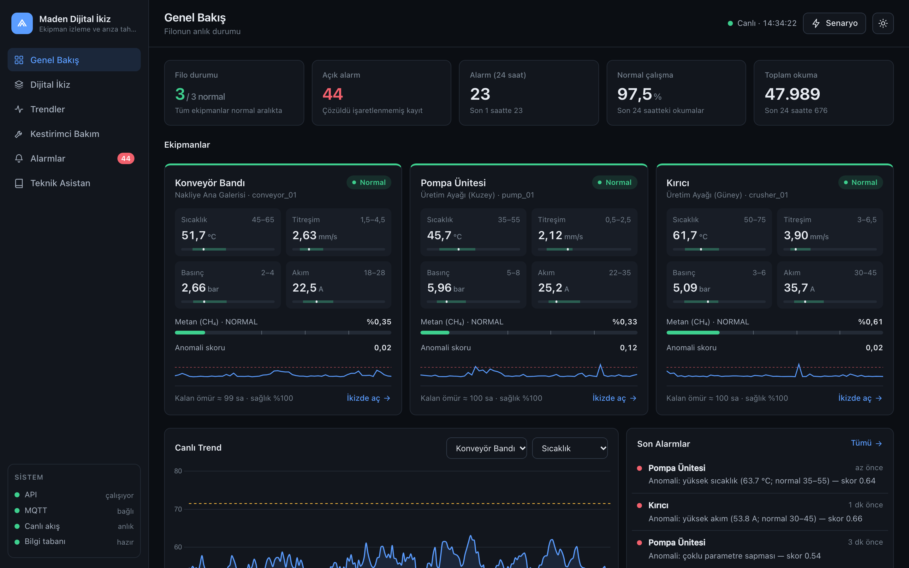
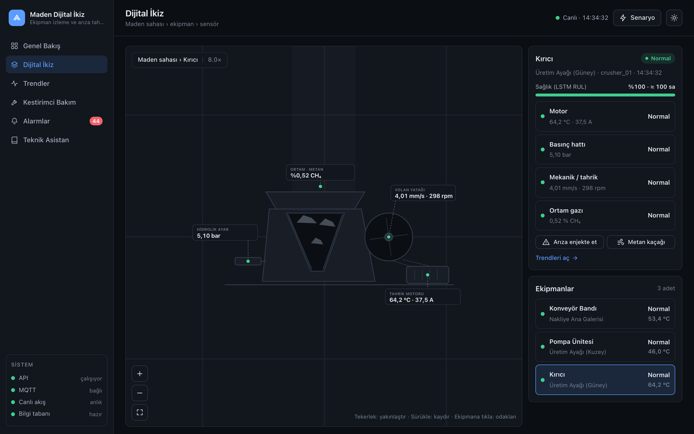
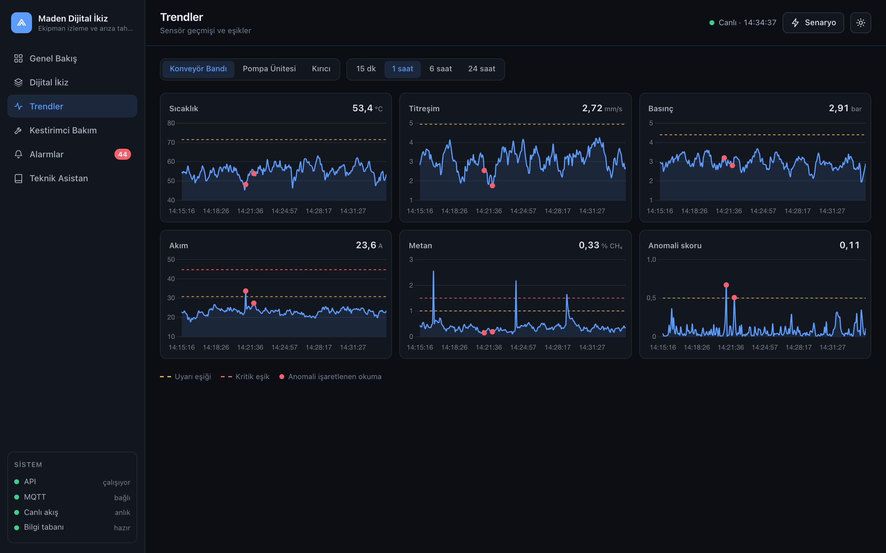
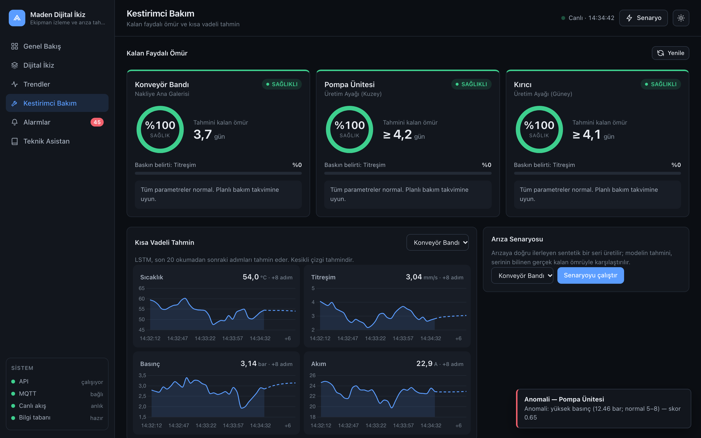
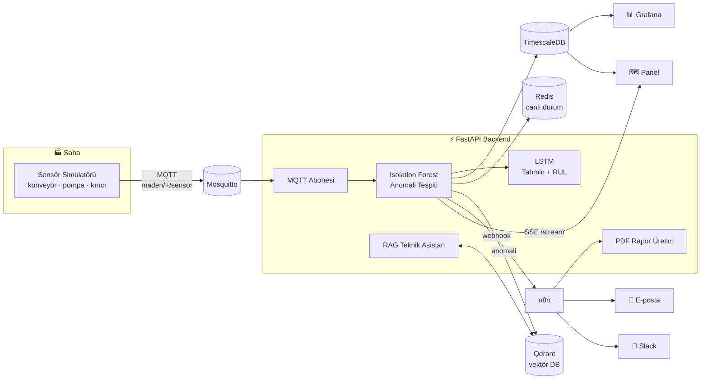

<div align="center">

# ⛏️ Maden Dijital İkiz

### Yapay Zekâ Destekli Maden Ekipmanı İzleme ve Arıza Tahmin Sistemi

*Sahadaki her sensör okumasını gerçek zamanlı işleyen, arızayı olmadan önce sezen<br/>ve teknisyene doğru dokümanı gösteren uçtan uca bir dijital ikiz platformu.*

<br/>


<br/>

| 🎯 Anomali Doğruluğu | 🚨 Yakalanan Arıza | 📈 ROC-AUC | ⏳ RUL Hatası (MAE) | 🔎 RAG hit@3 |
|:---:|:---:|:---:|:---:|:---:|
| **%99.1** | **%96.7** | **0.996** | **7.5 saat** | **%90** |

<sub>Değerler simülasyon verisi üzerinde, eğitimde kullanılmayan test kümelerinde ölçülmüştür — ayrıntı: <a href="#-model-değerlendirme">Model Değerlendirme</a></sub>

<br/><br/>



</div>

---

## 🧭 Neden?

Yeraltı madenlerinde bir konveyörün, pompanın ya da kırıcının **plansız duruşu**, saatler içinde ciddi üretim ve maliyet kaybına dönüşür. Klasik bakım ya çok erken (gereksiz masraf) ya da çok geç (arıza) yapılır.

**Maden Dijital İkiz**, ekipmanın sanal bir kopyasını canlı tutar:

- 📡 Sensör verisini **MQTT** üzerinden anlık toplar,
- 🧠 **Isolation Forest** ile anormal davranışı yakalar,
- 🔮 **LSTM** ile bir sonraki değerleri ve **Kalan Faydalı Ömrü (RUL)** tahmin eder,
- ☠️ **Metan (CH₄)** seviyesini yasal İSG eşikleriyle izler,
- 📖 Arıza anında **RAG** ile Sandvik LH517 servis dokümanlarından ilgili bölümü getirir,
- 📨 **n8n** ile PDF raporu üretip e-posta / Slack üzerinden ekibe ulaştırır.

---

## ✨ Özellikler

<table>
<tr>
<td width="50%" valign="top">

### 🛰️ Gerçek Zamanlı Veri Hattı
Simülatör → **MQTT** (`maden/{ekipman}/sensor`) → abone → **TimescaleDB** + **Redis**. Her 5 saniyede 3 ekipman için sıcaklık, titreşim, basınç, akım, hız ve gaz okuması; panele **SSE** ile anlık iletilir.

</td>
<td width="50%" valign="top">

### 🧠 Anomali Tespiti
Yalnızca normal çalışma verisiyle eğitilen **Isolation Forest** (300 ağaç). Girdiler ekipman profiline göre normalize edildiği için tek model tüm ekipmanları değerlendirir. Anomaliler Qdrant'a gömülerek **benzer geçmiş arızalar** aranabilir hâle gelir.

</td>
</tr>
<tr>
<td valign="top">

### 🔮 Tahmin & RUL
2 katmanlı **LSTM** (64 gizli birim, 20 adımlık pencere) sonraki sensör değerlerini; ayrı bir LSTM ise arızaya giden serilerden **Kalan Faydalı Ömrü** saat cinsinden tahmin eder.

</td>
<td valign="top">

### 📖 RAG Teknik Asistan
**Sandvik LH517** için küratörlü bilgi tabanı; `ml/ingest_docs.py` ile servis PDF'leri de parçalanıp eklenebilir. Yerel `all-MiniLM-L6-v2` (ücretsiz, dışa bağımsız) ya da isteğe bağlı OpenAI embedding.

</td>
</tr>
<tr>
<td valign="top">

### 🗺️ LOD Dijital İkiz Paneli
**Maden ⇄ Ekipman ⇄ Sensör** seviyeleri arasında yakınlaşan *Level of Detail* haritası; her ekipman tipinin kendi şeması ve ekipmana özel uyarı/kritik eşikleri. Koyu/açık tema, mobil uyum.

</td>
<td valign="top">

### ☠️ İSG — Metan İzleme
ML değil, **sabit yasal eşikler**: %1.0 uyarı · %1.5 elektrikli ekipmanı durdur · %2.0 **tahliye**. Alarm, seviye yükseldiğinde bir kez üretilir.

</td>
</tr>
<tr>
<td valign="top">

### 📨 Otomatik Raporlama
Son 24 saatin anomali/İSG özeti **PDF** olarak üretilir; n8n workflow'u raporu alıp **SMTP e-posta** ve **Slack** ile gönderir.

</td>
<td valign="top">

### 📊 Grafana
TimescaleDB'ye bağlı hazır provisioning'li dashboard ile tarihsel trend analizi.

</td>
</tr>
</table>

---

## 🖥️ Panel

| Dijital İkiz | Trendler |
|:---:|:---:|
|  |  |
| Saha haritasından ekipman şemasına, oradan sensöre yakınlaşma | Uyarı ve kritik eşikleriyle sensör geçmişi |

| Kestirimci Bakım | |
|:---:|:---|
|  | **Genel Bakış** — filo durumu, ekipman kartları, canlı trend<br/>**Alarmlar** — filtreleme, çözüldü işaretleme, alarma özel bakım önerisi (RAG), PDF rapor<br/>**Teknik Asistan** — servis dokümantasyonunda anlamsal arama<br/>**Senaryo** — tek tıkla arıza ya da metan kaçağı enjekte ederek tüm hattı sınama<br/><br/>Sunucu yokken panel `?demo` parametresiyle tarayıcıda üretilen örnek veriyle de açılır. |

---

## 🏗️ Mimari



---

## 🚀 Hızlı Başlangıç

> **Gereksinimler:** Docker Desktop, Python 3.11 veya 3.12

```bash
# 1) Depoyu klonla
git clone https://github.com/Yigithosta/digital_twin.git
cd digital_twin

# 2) Sanal ortam + bağımlılıklar
python3 -m venv .venv && source .venv/bin/activate
pip install -r requirements.txt

# 3) Altyapıyı ayağa kaldır (TimescaleDB, Qdrant, Redis, Mosquitto, n8n, Grafana)
cp .env.example .env
docker compose up -d

# 4) (Opsiyonel) Geçmiş veri yükle ve modelleri yeniden eğit
python data/seed.py
python ml/train.py

# 5) API'yi başlat — MQTT yayını ve anomali hattı otomatik çalışır
uvicorn main:app --reload --port 8000
```

Ardından tarayıcıda:

| | Adres |
|---|---|
| 🗺️ **Panel** | http://localhost:8000 |
| 📘 **Swagger API Dokümanı** | http://localhost:8000/docs |
| 📊 Grafana | http://localhost:3000 |
| 🔁 n8n | http://localhost:5678 |
| 🧲 Qdrant UI | http://localhost:6333/dashboard |

> Tüm ayarlar isteğe bağlıdır ve `.env` dosyasından okunur; seçenekler [`.env.example`](.env.example) içinde açıklanmıştır. Altyapı servislerinden biri çalışmıyorsa API yine açılır; durum `GET /health` ile ve panelin *Sistem* kutusundan izlenir.

---

## 🔌 API

| Modül | Uç Nokta | Açıklama |
|---|---|---|
| **Sistem** | `GET /health` | Bileşen bazında sağlık (veritabanı, MQTT, Redis, Qdrant) |
| | `GET /equipment` | Ekipman kataloğu: birimler ve sensör başına çalışma sınırları |
| | `GET /stream` | Canlı akış (SSE): `reading` ve `alarm` olayları |
| **Sensörler** | `POST /sensors/reading` | Yeni okuma al, anında anomali skorla |
| | `GET /sensors/latest/{equipment_id}` · `/history/{equipment_id}` | Son okuma · geçmiş |
| | `POST /sensors/simulate/{equipment_id}` | Test okuması üret (`force_anomaly`, `force_gas`) |
| **Anomaliler** | `GET /anomalies/` | Alarm kayıtları (ekipman / durum filtresi) |
| | `POST /anomalies/{id}/resolve` · `/anomalies/resolve-all` | Çözüldü işaretle |
| | `GET /anomalies/similar` | Qdrant ile benzer geçmiş arızalar |
| **Tahmin** | `GET /predict/{equipment_id}?steps=6` | LSTM ile sonraki adımlar |
| | `GET /predict/rul/{equipment_id}` | Kalan Faydalı Ömür (RUL) |
| **RAG** | `POST /rag/sor` | Teknik dokümana soru sor |
| | `GET /rag/anomali-asistan` | Anomaliye göre ilgili bakım bilgisi |
| | `GET /rag/status` · `POST /rag/indeks` | Bilgi tabanı durumu / yeniden indeksleme |
| **Panel** | `GET /dashboard/summary` · `/latest-all` · `/recent-anomalies` | Özetler |
| | `GET /dashboard/timeseries/{equipment_id}/{metric}` | Zaman serisi (uzun aralıklar seyreltilir) |
| **Rapor** | `GET /report/anomali-pdf` | Son 24 saat PDF raporu |

Etkileşimli doküman: http://localhost:8000/docs

---

## 📏 Model Değerlendirme

```bash
python ml/train.py          # üç modeli eğitir, doğrulama metriklerini yazar
python ml/evaluate.py       # Isolation Forest — 20.000 örneklik bağımsız etiketli test kümesi
python ml/evaluate_rag.py   # RAG — hit@3, ortalama benzerlik, dokümana sadakat
python ml/ingest_docs.py    # Servis PDF'lerini parçala → embed → Qdrant
pytest                      # birim ve API testleri (altyapı gerektirmez)
```

| Model | Metrik | Sonuç |
|---|---|---|
| Isolation Forest | Doğruluk · ROC-AUC | **%99.1** · **0.996** |
| Isolation Forest | Yakalanan arıza (recall) · Kesinlik | **%96.7** · **%98.4** |
| Isolation Forest | Yanlış alarm oranı | **%0.37** |
| LSTM tahminci | Doğrulama RMSE | **0.79 σ** (son değeri tekrar etme: 1.06 σ) |
| LSTM RUL | Doğrulama MAE | **7.5 saat** (arızaya son 24 saatte **5.2 saat**) |
| RAG (Sandvik LH517) | hit@3 | **%90** (10 soruluk küme) |
| RAG | Halüsinasyon | Yapısal olarak engelli — yanıtlar yalnızca bilgi tabanından döner |

> **Not:** Sistem şu an saha simülatörünün ürettiği veriyle çalışır; yukarıdaki değerler de bu veri üzerinde, eğitimde kullanılmayan test kümeleri ve serilerle ölçülmüştür. Gerçek saha verisine geçildiğinde ekipman profilleri güncellenmeli ve modeller yeniden doğrulanmalıdır.

---

## 🧪 Prototipler

`prototypes/` altında bağımsız açılabilen HTML prototipleri:

- 🚜 **`vehicle_twin/`** — Sandvik LH517 yükleyicinin sensörleri makine üzerinde gösteren 2D araç ikizi
- 🗺️ **`lod_mine/`** — Zoom yapıldıkça tünel → araç → bileşen detayı açılan yeraltı maden haritası
- 🕳️ **`tunnel_schema/`** — Madencilik tünel şeması

---

## 📂 Proje Yapısı

```
digital_twin/
├── main.py                  # FastAPI giriş noktası, saha simülatörü döngüsü
├── app/
│   ├── config.py            # ortam ayarları, ekipman kataloğu
│   ├── routers/             # dashboard · sensors · anomalies · predict · rag · report
│   ├── services/            # pipeline (ortak veri hattı) · anomaly_detector · lstm_predictor
│   │                        # rag_service · embedding_service · mqtt_subscriber · events (SSE)
│   │                        # n8n_notifier · report_generator
│   └── models/ · schemas/   # SQLAlchemy modelleri, Pydantic şemaları
├── data/                    # simülatör, MQTT yayıncı, seed, Kaggle veri seti
├── ml/                      # eğitim, değerlendirme, doküman ingest, eğitilmiş LSTM modelleri
├── static/                  # panel: index.html · css/ · js/ (derleme adımı yok)
├── tests/                   # pytest
├── prototypes/              # araç ikizi, LOD maden, tünel şeması
├── n8n/ · grafana/ · mosquitto/
└── docker-compose.yml
```

---

<div align="center">

## 👤 Geliştirici

**Yiğit Ahmet Hosta**

[](https://github.com/Yigithosta)

<sub>⛏️ Madenler için daha güvenli, daha öngörülebilir bir gelecek.</sub>

</div>
