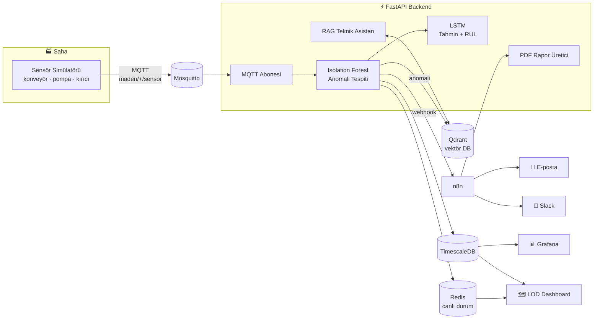

<div align="center">

# ⛏️ Maden Dijital İkiz

### Yapay Zekâ Destekli Maden Ekipmanı İzleme ve Arıza Tahmin Sistemi

*Sahadaki her sensör okumasını gerçek zamanlı işleyen, arızayı olmadan önce sezen<br/>ve teknisyene doğru dokümanı gösteren uçtan uca bir dijital ikiz platformu.*

<br/>


<br/>

| 🎯 Anomali Doğruluğu | 📈 ROC-AUC | 🔎 RAG hit@3 | 📚 Teknik Doküman Vektörü |
|:---:|:---:|:---:|:---:|
| **%90.6** | **0.983** | **%90** | **147** |

</div>

---

## 🧭 Neden?

Yeraltı madenlerinde bir konveyörün, pompanın ya da kırıcının **plansız duruşu**, saatler içinde ciddi üretim ve maliyet kaybına dönüşür. Klasik bakım ya çok erken (gereksiz masraf) ya da çok geç (arıza) yapılır.

**Maden Dijital İkiz**, ekipmanın sanal bir kopyasını canlı tutar:

- 📡 Sensör verisini **MQTT** üzerinden anlık toplar,
- 🧠 **Isolation Forest** ile anormal davranışı yakalar,
- 🔮 **LSTM** ile bir sonraki değerleri ve **Kalan Faydalı Ömrü (RUL)** tahmin eder,
- ☠️ **Metan (CH₄)** seviyesini yasal İSG eşikleriyle izler,
- 📖 Arıza anında **RAG** ile Sandvik LH517 servis dokümanlarından ilgili bölümü getirir,
- 📨 **n8n** ile PDF raporu üretip e-posta / Slack üzerinden ekibe ulaştırır.

---

## ✨ Özellikler

<table>
<tr>
<td width="50%" valign="top">

### 🛰️ Gerçek Zamanlı Veri Hattı
Simülatör → **MQTT** (`maden/{ekipman}/sensor`) → abone → **TimescaleDB** + **Redis**. Her 8 saniyede 3 ekipman için sıcaklık, titreşim, basınç, akım, hız ve gaz okuması.

</td>
<td width="50%" valign="top">

### 🧠 Anomali Tespiti
Kaggle *Predictive Maintenance* verisiyle eğitilmiş **Isolation Forest** (200 ağaç). Her okuma anında skorlanır; anomaliler Qdrant'a gömülerek **benzer geçmiş arızalar** aranabilir hâle gelir.

</td>
</tr>
<tr>
<td valign="top">

### 🔮 Tahmin & RUL
2 katmanlı **LSTM** (64 gizli birim, 20 adımlık pencere) sonraki sensör değerlerini; ayrı bir LSTM ise **Kalan Faydalı Ömrü** saat cinsinden tahmin eder. Apple Silicon'da **MPS** hızlandırma.

</td>
<td valign="top">

### 📖 RAG Teknik Asistan
**Sandvik LH517** spesifikasyon ve servis dokümanlarından çıkarılan 133 parça + küratörlü bilgi tabanı. Yerel `all-MiniLM-L6-v2` (ücretsiz, dışa bağımsız) ya da isteğe bağlı OpenAI embedding.

</td>
</tr>
<tr>
<td valign="top">

### 🗺️ LOD Dijital İkiz Paneli
Tek ekranda **Maden ⇄ Araç ⇄ Bileşen** seviyeleri arasında yakınlaşan *Level of Detail* görünümü; D3 + Chart.js ile canlı grafikler.

</td>
<td valign="top">

### ☠️ İSG — Metan İzleme
ML değil, **sabit yasal eşikler**: %1.0 uyarı · %1.5 elektrikli ekipmanı durdur · %2.0 **tahliye**.

</td>
</tr>
<tr>
<td valign="top">

### 📨 Otomatik Raporlama
Son 24 saatin anomali/İSG özeti **PDF** olarak üretilir; n8n workflow'u raporu alıp **SMTP e-posta** ve **Slack** ile gönderir.

</td>
<td valign="top">

### 📊 Grafana
TimescaleDB'ye bağlı hazır provisioning'li dashboard ile tarihsel trend analizi.

</td>
</tr>
</table>

---

## 🏗️ Mimari



---

## 🚀 Hızlı Başlangıç

> **Gereksinimler:** Docker Desktop, Python 3.11 veya 3.12

```bash
# 1) Depoyu klonla
git clone https://github.com/Yigithosta/digital_twin.git
cd digital_twin

# 2) Sanal ortam + bağımlılıklar
python3 -m venv .venv && source .venv/bin/activate
pip install -r requirements.txt
pip install fpdf2 pdfplumber   # PDF rapor + doküman ingest

# 3) Altyapıyı ayağa kaldır (TimescaleDB, Qdrant, Redis, Mosquitto, n8n, Grafana)
docker compose up -d

# 4) (Opsiyonel) Geçmiş veri yükle ve modelleri yeniden eğit
python data/seed.py
python ml/train.py

# 5) API'yi başlat — MQTT yayını ve anomali hattı otomatik çalışır
uvicorn main:app --reload --port 8000
```

Ardından tarayıcıda:

| | Adres |
|---|---|
| 🗺️ **Canlı Dijital İkiz Paneli** | http://localhost:8000/static/demo.html |
| 📘 **Swagger API Dokümanı** | http://localhost:8000/docs |
| 📊 Grafana | http://localhost:3000 |
| 🔁 n8n | http://localhost:5678 |
| 🧲 Qdrant UI | http://localhost:6333/dashboard |

<details>
<summary>⚙️ <b>Ortam değişkenleri (<code>.env</code>)</b></summary>

<br/>

Tümü opsiyoneldir; verilmezse aşağıdaki varsayılanlar kullanılır.

```env
POSTGRES_USER=postgres
POSTGRES_PASSWORD=postgres
POSTGRES_HOST=localhost
POSTGRES_PORT=5432
POSTGRES_DB=digital_twin

MQTT_HOST=localhost
MQTT_PORT=1883

N8N_WEBHOOK_URL=http://localhost:5678/webhook/anomali-alarm

# local (MiniLM, varsayılan) | openai
EMBEDDING_BACKEND=local
# OPENAI_API_KEY=...
```

</details>

---

## 🔌 API

| Modül | Uç Nokta | Açıklama |
|---|---|---|
| **Sensörler** | `POST /sensors/reading` | Yeni okuma al, anında anomali skorla |
| | `GET /sensors/latest/{equipment_id}` | Son okuma |
| | `GET /sensors/history/{equipment_id}` | Okuma geçmişi |
| | `POST /sensors/simulate/{equipment_id}` | Simüle okuma üret |
| **Anomaliler** | `GET /anomalies/` | Anomali kayıtları |
| | `POST /anomalies/{id}/resolve` | Anomaliyi çözüldü işaretle |
| | `GET /anomalies/similar` | Qdrant ile benzer geçmiş arızalar |
| **Tahmin** | `GET /predict/{equipment_id}` | LSTM ile sonraki değerler |
| | `GET /predict/rul/{equipment_id}` | Kalan Faydalı Ömür (RUL) |
| **RAG** | `POST /rag/sor` | Teknik dokümana soru sor |
| | `GET /rag/anomali-asistan` | Anomaliye göre ilgili bakım bilgisi |
| | `GET /rag/status` · `POST /rag/indeks` | Bilgi tabanı durumu / yeniden indeksleme |
| **Dashboard** | `GET /dashboard/summary` · `/latest-all` · `/recent-anomalies` | Panel özetleri |
| | `GET /dashboard/timeseries/{equipment_id}/{metric}` | Zaman serisi |
| | `GET /dashboard/mqtt-status` | MQTT bağlantı durumu |
| **Rapor** | `GET /report/anomali-pdf` | Son 24 saat PDF raporu |

---

## 📏 Model Değerlendirme

```bash
python ml/evaluate.py       # Isolation Forest — 4000 örneklik bağımsız etiketli test kümesi
python ml/evaluate_rag.py   # RAG — hit@3, ortalama benzerlik, dokümana sadakat
python ml/ingest_docs.py    # Sandvik PDF'lerini parçala → embed → Qdrant
```

| Model | Metrik | Sonuç |
|---|---|---|
| Isolation Forest | Doğruluk | **%90.6** |
| Isolation Forest | ROC-AUC | **0.983** |
| RAG (Sandvik LH517) | hit@3 | **%90** |
| RAG | Halüsinasyon | Yapısal olarak engelli — yanıtlar yalnızca bilgi tabanından döner |

---

## 🧪 Prototipler

`prototypes/` altında bağımsız açılabilen HTML prototipleri:

- 🚜 **`vehicle_twin/`** — Sandvik LH517 yükleyicinin sensörleri makine üzerinde gösteren 2D araç ikizi
- 🗺️ **`lod_mine/`** — Zoom yapıldıkça tünel → araç → bileşen detayı açılan yeraltı maden haritası
- 🕳️ **`tunnel_schema/`** — Madencilik tünel şeması

---

## 📂 Proje Yapısı

```
digital_twin/
├── main.py                  # FastAPI giriş noktası, MQTT yayın döngüsü
├── app/
│   ├── routers/             # sensors · anomalies · predict · rag · dashboard · report
│   ├── services/            # anomaly_detector · lstm_predictor · rag_service
│   │                        # embedding_service · mqtt_subscriber · n8n_notifier · report_generator
│   ├── models/ · schemas/   # SQLAlchemy modelleri, Pydantic şemaları
│   └── database.py · redis_client.py
├── data/                    # simülatör, MQTT yayıncı, seed, Kaggle veri seti
├── ml/                      # eğitim, değerlendirme, doküman ingest, eğitilmiş modeller
├── static/demo.html         # LOD dijital ikiz paneli
├── prototypes/              # araç ikizi, LOD maden, tünel şeması
├── n8n/                     # anomali → PDF → e-posta/Slack workflow'u
├── grafana/                 # dashboard + provisioning
├── mosquitto/               # MQTT broker yapılandırması
└── docker-compose.yml
```

---

<div align="center">

## 👤 Geliştirici

**Yiğit Ahmet Hosta**

[](https://github.com/Yigithosta)

<sub>⛏️ Madenler için daha güvenli, daha öngörülebilir bir gelecek.</sub>

</div>
